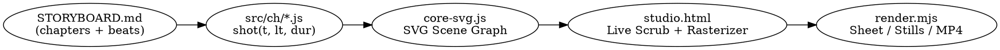

# SVG Video Engine (`svg-video-engine`)

## Overview

Build deterministic, resolution-independent **1920×1080 SVG animations** driven by pure functions of time `f(t)` and rendered in parallel via headless Chrome (`puppeteer-core`) + `ffmpeg`.

Every frame is a **stateless mathematical function of `t` (seconds)**—enabling instant timeline scrubbing in the browser, multi-worker out-of-order rendering, contact-sheet visual QA (`--sheet`), and razor-sharp vector geometry at any zoom level.

## When to Use

- Producing full-length animated videos (explainers, music videos, technical animations, Kurzgesagt / Flash / motion-graphics style) using pure SVG.
- Animating vector characters with hierarchical 2-bone FK or analytical 2-bone IK, facial morphs, and beat-synced motion.
- Choreographing SVG stroke drawing (`stroke-dasharray`), motion along arbitrary bezier paths with tangent alignment, polygon/path morphing, camera pans/zooms, and SVG filter effects (`feGaussianBlur` bloom, `feTurbulence` + `feDisplacementMap` 12fps hand-drawn boil).
- Rendering deterministic contact sheets (`--sheet`) and 60fps/24fps MP4s (`--frames` + `--encode` or `--clip`).

**When NOT to use:**
- Simple hover/scroll micro-interactions on a marketing webpage (use `gsap-core` or `animejs`).
- Photorealistic 3D scenes with PBR shaders and rigid-body physics (use `react-three-fiber` / `threejs-*`).

## Core Architecture & Contract



### 1. The Pure-Function Law (`f(t)`)
Frames render **in parallel and out of order** across multiple headless Chrome workers:
- **Zero state between frames:** Never accumulate position (`x += vx`), never use `requestAnimationFrame` state loops for scene logic, and never call `Math.random()`.
- **Deterministic PRNG & 12fps Boil:** Use `hash(seed)` for static variation and `jit(amount)` seeded by `Math.floor(t * 12)` for hand-drawn line boil.
- **Chapter & Shot Signature:** Every shot is `function shotName(t, lt, dur)` where `t` = global video time, `lt` = `t - shotStart`, and `dur` = `shotEnd - shotStart`.

### 2. The 5 Critical SVG Video Traps (And Mandatory Fixes)

| Trap | Why It Breaks in SVG Video Rendering | Mandatory Fix in `core-svg.js` |
|---|---|---|
| **1. `stroke-dasharray="1"` + `stroke-dashoffset="1"`** | A pattern of `"1"` means `1 ON, 1 OFF` repeating. Shifting by `dashoffset="1"` pulls the previous ON segment onto `[0, 1]`, making the path **100% visible at progress = 0**! | Always set `pathLength="1"` and `stroke-dasharray="${p} 2"` (gap `2` > path length `1`), with `stroke-dashoffset="0"`. |
| **2. `stroke-linecap="round"` zero-length dot** | Even when dash length is `0`, SVG spec renders two half-circle round caps at the start point, leaving a visible dot at `p = 0`. | Hide the stroke when `p <= 0.001` (`opacity: p <= 0.001 ? 0 : 1`). |
| **3. `XMLSerializer` + `Blob` -> `new Image()` loses external fonts** | Browser security blocks all external `<link>` / `@import` Google Fonts inside ``-loaded SVG blobs, silently reverting `<text>` to `Times New Roman`. | Either inline font `@font-face` as a base64 `data:font/woff2;base64,...` inside `<svg><defs><style>`, OR draw text/captions on the composite `<canvas>` layer after rasterizing the SVG geometry. |
| **4. Per-frame `document.createElement('canvas')` leak** | Creating a new 1920×1080 `<canvas>` every frame leaks GPU backing stores across thousands of frames. | Reuse a single module-scoped `outCanvas` (1920×1080) and `svgImg = new Image()`. |
| **5. Incompatible `renderAt` / `renderSheet` signatures** | `render.mjs` passes `(t, type, q)` to `window.renderAt` and expects `{ url, ms }` from `window.renderSheet(times, cols, w)` plus `window.ready = true`. | Implement the exact `window.ready`, `window.renderAt(t, type, q)`, and `window.renderSheet(times, cols, w)` contract from [assets/templates/core-svg.js](assets/templates/core-svg.js). |

## Quick Reference (`core-svg.js` Primitives)

Full implementation and advanced rigging in [references/svg-engine-api.md](references/svg-engine-api.md).

| Category | Helper | Usage |
|---|---|---|
| **Timing & Easing** | `seg(t, a, b)`, `kf(t, keys, easeFn)` | `seg(lt, 0.2, 1.4)` → `0..1`; `kf(lt, [[0, 100], [1, 500], [2, 300]], backOut)` |
| **Beats & Boil** | `bpOf(t)`, `pulse(t, k)`, `hash(i)`, `jit(a)` | `pulse(t, 6)` spikes to `1` on every beat; `jit(3)` wobbles at 12fps |
| **Camera** | `camBegin(cx, cy, zoom, rotDeg)` / `camEnd()` | Wraps scene elements in `<g transform="translate(960,540) scale(z) rotate(r) translate(-cx,-cy)">` |
| **Shapes** | `rect()`, `circ()`, `ell()`, `poly()`, `star()`, `path()` | Declarative SVG nodes appended to current parent/camera group |
| **Stroke Draw** | `drawPath(d, progress, opts)` | Safe `pathLength="1"` reveal from `u0` to `u1` with zero round-cap artifact |
| **Motion Path** | `pointOnPath(d, u)` | Returns `{ x, y, angleDeg }` at normalized progress `u` (`0..1`) using cached SVGGeometryElement |
| **Shape Morph** | `morphPath(ptsA, ptsB, u, closed)` | Interpolates point arrays or resampled polygons smoothly |
| **Character Rig** | `bone(x, y, deg, fn)`, `ik2Bone(sx, sy, tx, ty, L1, L2, bend)` | Hierarchical FK groups + exact analytical 2-bone IK solver for arms/legs |
| **SVG Filters** | `useFilter('glow')`, `useFilter('boil')` | Built-in bloom glow and 12fps turbulent hand-drawn ink boil |

## Production Workflow

1. **Scaffold Project**:
   Copy [assets/templates/studio-svg.html](assets/templates/studio-svg.html), [assets/templates/core-svg.js](assets/templates/core-svg.js), and [assets/templates/render.mjs](assets/templates/render.mjs) into the project root.
2. **Design Storyboard & Palette (`STORYBOARD.md`)**:
   Define BPM, beat offset, color palette (`PAL`), reusable characters (`src/cast.js`), and shot timestamps (`1.5s–4.0s` per shot, one clear silhouette/focal gag per shot).
3. **Implement Chapters (`src/ch/c01_*.js`)**:
   Wrap each chapter in an IIFE calling `chapter(name, start, end, [[t0, shotA], [t1, shotB]])`. Keep critical action above `y = 960` if using the bottom karaoke/caption band.
4. **Visual QA with Contact Sheets (MANDATORY before full render)**:
   ```bash
   node render.mjs --sheet=0.2,0.8,1.5,2.2,3.0,3.8 --cols=3 --w=640 --out=out/check/c01.jpg
   ```
   Open `out/check/c01.jpg` with `Read` and verify:
   - First, middle, and last frame of every shot read clearly.
   - Zero stray dots on un-drawn paths (`p = 0`).
   - Motion arcs, IK limbs, and camera framing have strong contrast and no text clipping.
5. **Parallel Full Render & Encode**:
   ```bash
   node render.mjs --frames=0:60 --workers=4 --fps=24
   node render.mjs --encode --fps=24 --audio=assets/song.mp3 --out=out/video.mp4
   ```

## Rationalization Table & Red Flags

| Excuse / Temptation | Reality |
|---|---|
| "I'll use `stroke-dasharray='1'` and `stroke-dashoffset={1 - p}` for path drawing." | **Broken at `p = 0`.** Dasharray `"1"` repeats `[1 on, 1 off]`, so `dashoffset="1"` draws the entire path at `p = 0` plus round-cap dots. Use `stroke-dasharray="${p} 2"` and hide when `p <= 0.001`. |
| "I'll use CSS `@keyframes` or GSAP tweens without seeking for headless rendering." | **Broken in parallel rendering.** Wall-clock animations do not sync to arbitrary `window.renderAt(t)` calls. Compute every attribute directly from `t` (or seek a paused timeline deterministically via `tl.time(t)`). |
| "I'll skip `--sheet` inspection and render the MP4 directly." | **Forbidden.** Always generate and inspect a contact sheet with `Read` to catch coordinate, layer-order, and framing bugs in 2 seconds instead of waiting minutes. |
| "I'll put `<link href='https://fonts.googleapis.com/...'>` in `<head>` and use `<text>` inside the serialized SVG." | **Fonts will silently reset to Times New Roman.** `new Image()` blocks external resources inside SVG blobs. Render typography on the composite 2D canvas overlay (`letter()`, `drawKaraoke()`) or embed base64 `@font-face` inside `<svg><style>`. |
